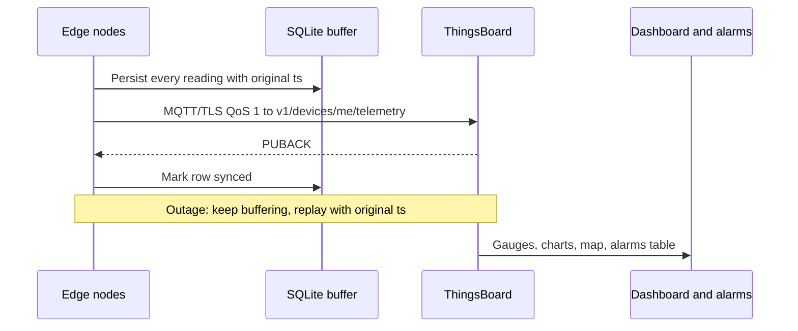

# Cloud track implementation and handoff

Anushree's detailed ThingsBoard provisioning, eight-widget dashboard specification,
evidence checklist and manuscript draft are in [ANUSHREE.md](ANUSHREE.md) and
[ANUSHREE_MANUSCRIPT.md](ANUSHREE_MANUSCRIPT.md). The profile, three devices and dashboard were created on the EU Cloud tenant on 25 November 2026. The API dashboard JSON, redacted profile snapshot and timestamp comparison are in `exports/`; genuine dashboard screenshots and UI import checks are captured in `cloud/evidence/` and `evidence/`.
`python -m cloud.provision --dry-run` is the default and validates the committed
artifacts without network traffic. Anushree's repeatable device setup is now a
separate mode: save a ThingsBoard API key in ignored `.thingsboard-auth` (key only,
one line) or set `TB_AUTH`, then run `python -m cloud.provision --device-setup`.
The default URL is the user's `https://eu.thingsboard.cloud`; set `TB_URL` to
override it. The API snapshot it writes is redacted evidence, not a UI export.

This repository implements the edge simulator and now includes provisioning and dashboard configuration for the cloud half. This document is the
actionable checklist for the Cloud Track members: Anushree Pradhan (provisioning and
dashboard) and Sambid Shrestha (alarm rules, WQI rule chain and benchmarking).

Sources for this checklist: `INTEGRATION.md` in this repo (the exact wire/payload/alarm
contract), Assessment Task 3 section C and its metrics table, and the group work-division
PDF. Where the assignment and this repo differ, both values are stated so nothing is
guessed.

## Handoff at a glance

The edge code already implements everything to the left of ThingsBoard: sensor models,
DSP, alarms, validity gates, store-and-forward, per-node MQTT clients and replay. Cloud
work starts at the ThingsBoard instance.

## Ready-to-import artifacts

These files are configuration **templates**; importing them is still a Cloud Track
action on a real instance and no credentials are stored in them.

| Artifact | Purpose | Apply |
| --- | --- | --- |
| `cloud/artifacts/device_profile.json` | Device profile with **all nine alarm rules** in the native Device Profile → Alarm Rules tab (six direct thresholds + three edge-derived mirrors) | `python -m cloud.provision --apply` |
| `cloud/artifacts/devices.json` | Three devices with `${TB_TOKEN_*}` placeholders and site coordinates | tokens filled from `.env` by `cloud.provision` |
| `cloud/artifacts/dashboard_triage.json` | **Eight-widget triage dashboard**: pH/turbidity radial gauges, TDS digital gauge, multi-parameter chart, temperature/flow chart, severity map, alarms table and node-status entity table | `python -m cloud.provision --apply` (preferred) or UI: **Dashboards → Import** |
| `cloud/artifacts/dashboard_thingsboard_cloud.json` | **Verified-importable fallback**: six native line charts cloned from a real ThingsBoard Cloud export, bound directly to a `deviceId` | UI fallback if the triage import fails |
| `cloud/artifacts/wqi_rule_chain.json` | Native Rule Chains tab: only the server-side WQI script (explicit Task 3 deliverable) plus `server_received_ms` for latency | `python -m cloud.provision --apply --set-root` (opt-in) |
| `cloud/artifacts/wqi_server_script.js` | Readable copy of the WQI rule-node script | embedded in the rule chain JSON |
| `cloud/artifacts/alarm_rules.json` | Declarative nine-rule spec with exact deadbands/debounce | documentation and test fixture |
| `cloud/artifacts/alarm_rules_import/` | Nine importable per-rule `ALARM` documents | use **Alarm rules → Import** on current Cloud tenants |

**Which dashboard to import:** use `dashboard_triage.json`. It is derived from the
verified six-chart Cloud export that the user confirmed is working in ThingsBoard:
the same widget `settings`, raw `NONE` aggregation, 24-hour timewindow, visible
sample points and direct `deviceId` datasources are retained. The earlier
alias-based `dashboard.json` and the `dashboard_minimal.json` diagnostic were used
during troubleshooting and are not committed final artifacts; that template was
silently rejected by Cloud UI import. The six-chart
`dashboard_thingsboard_cloud.json` remains committed as a safe fallback and is used
by `cloud.provision` only if the triage file is absent.

The three device IDs embedded in both dashboards are node-a
`81e5b1f0-e883-11f1-ab4e-dfd4fe9de952`, node-b
`01f214e0-e886-11f1-b8ac-4bd49425d19e` and node-c
`0bb52a80-e886-11f1-86e5-9755011de358`. The two charts and the three map markers use
direct device bindings; the gauges are fixed to node-a; the alarms table and
node-status table use an explicit `entityList` alias containing all three IDs. The map
colours a marker from the published `severity` key when present. If the tenant has no
`severity` telemetry, the same colour bands are derived from `active_alarms`,
`turbidity_ntu`, `ph`, `tds_ppm` and `flow_lpm`, so the markers still draw. This avoids
the unresolved `stateEntity` and `deviceType` aliases that caused blank widgets on the
first import.

**Verification status:** the six-chart fallback is confirmed working on the user's
tenant. The eight-widget triage file is generated from that working export, passes
offline validation, and its tenant rendering is captured in
`evidence/Dashboard_8_widgets.png` and `evidence/Last_widget.png`. If a future import
fails, keep the six-chart file and add the extra widgets manually on the tenant, then
re-export.

### Native ThingsBoard tabs used

| Tab | What is configured there |
| --- | --- |
| Device Profiles | Profile `post-flood-water-quality` with all nine alarm rules (declarative conditions — no custom alarm scripts) |
| Devices | `node-a`, `node-b`, `node-c`, their access tokens, and the server-scope `inactivityTimeout` attribute |
| Dashboards | `dashboard_triage.json` contains the eight native triage widgets; `dashboard_thingsboard_cloud.json` is the confirmed six-chart fallback |
| Alarms | Alarm state is created by the device-profile rules; the triage dashboard's native alarms-table widget displays active and cleared alarms. No custom alarm rule chain is needed |
| Rule Chains | Only the WQI transform chain — required by the assignment for a server-side WQI implementation; all alarms deliberately stay in the Alarm Rules tab |

UI-only workflow (no scripts needed): **Device Profiles → Import** the profile, inspect
its **Alarm Rules** subtab (nine rules); **Devices → Import** the device inventory and
paste the three tokens; **Dashboards → Import** the dashboard; **Rule Chains → Import**
the WQI chain if the server-side WQI evidence is required; then use the **Alarms** tab to
verify raise/clear events during a demo. `cloud.provision` merely automates these same
native operations over REST.

`python -m cloud.provision --dry-run` validates all four import files without network
traffic. `--apply` needs `TB_HOST` plus either `TB_JWT` or
`TB_ADMIN_USER`/`TB_ADMIN_PASSWORD`, and the three tokens in the environment; it
never writes credentials to disk. `--device-setup` is the separate Anushree
profile/device path and uses `TB_URL` plus `TB_AUTH`/`.thingsboard-auth`; it writes
device tokens only to the ignored local `.env`. `python -m cloud.benchmark` (optionally `--apply
--plot`) produces the real-broker measurement table described in
`cloud/benchmark/README.md`. The Cloud Track manuscript text and final two-run
measurements are collected in `cloud/MANUSCRIPT.md`; the compiled IEEE source is in
`paper/`.

## Connect the edge to ThingsBoard

1. Copy `.env.example` to `.env` and set `TB_HOST`, `TB_CA_CERT` and the three token
   variables. `.env` is git-ignored and must never be committed.
2. Run `python -m edge.cli --mqtt`. The default `--dry-run` emits no network traffic.
3. Confirm `PUBLISH node=...` and `BUFFER: total=...` markers in the console or
   `logs/edge.log`, then confirm the same rows appear in ThingsBoard.
4. Check timestamp preservation: every row carries `{"ts": <epoch ms>, "values": {...}}`.
   ThingsBoard must store that client timestamp, not server receipt time, or the outage
   backfill will appear as a flat spike at recovery time.
5. Keep device names as `node-a`, `node-b`, `node-c`; the edge derives the token variable
   from the node id and will not fall back silently on an empty token.

## Provisioning (Anushree)

- [ ] Choose an instance: `demo.thingsboard.io` or self-hosted Docker CE.
- [ ] Create a Device Profile (import `cloud/artifacts/device_profile.json`, then verify
      the imported alarm rules in the UI).
- [ ] Set the inactivity timeout to detect node loss. The work division specifies
      180 min normal / 45 min burst; the edge's own `Node Inactive` alarm uses a 90 s demo
      value. These are separate mechanisms — document both rather than equating them.
      On ThingsBoard CE 3.x the timeout is a **server-scope device attribute**
      `inactivityTimeout` in milliseconds, not a profile field; `cloud.provision` sets
      10800000 ms (180 min) by default and `--inactivity-ms 2700000` selects the 45 min
      burst value. The profile alarm `"Node Inactive"` watches the resulting `active` key.
- [ ] Create at least three devices at distinct coordinates, named `node-a`, `node-b`,
      `node-c`. Coordinates published by the edge: 27.7172/85.3240, 27.6790/85.3190 and
      27.7500/85.3700. `cloud/artifacts/devices.json` contains this exact inventory with
      token placeholders.
- [ ] Generate an access token per device and put them in `.env` as
      `TB_TOKEN_NODE_A`, `TB_TOKEN_NODE_B`, `TB_TOKEN_NODE_C`.
- [ ] Export the Device Profile JSON for the submission archive.

## Operational dashboard (Anushree)

The eight-widget triage view answers "which source is unsafe right now?" within five
seconds. The artifact is `cloud/artifacts/dashboard_triage.json`.

| Widget | Type in artifact | Bound telemetry | Requirement |
| --- | --- | --- | --- |
| pH gauge | `system.analogue_gauges.radial_gauge_canvas_gauges` | node-a `ph` | Red `<6.5`, green `6.5–8.5`, red `>8.5` |
| Turbidity gauge | `system.analogue_gauges.radial_gauge_canvas_gauges` | node-a `turbidity_ntu` | Banded at 5/50/200 NTU |
| TDS digital gauge | `system.digital_gauges.gauge_justgage` | node-a `tds_ppm` | Banded at 500/1000 ppm |
| Multi-parameter time series | `system.line_chart` | `ph`, `turbidity_ntu`, `tds_ppm` for all three nodes | Shows intrusion and backfilled gap |
| Temperature and flow | `system.line_chart` | `water_temp_c`, `flow_lpm` for all three nodes | Supply-continuity view |
| Node map | `system.map` | direct device telemetry `latitude`, `longitude` plus raw alarm channels | Severity colouring with raw-telemetry fallback |
| Alarms table | `system.alarm_widgets.alarms_table` | fleet alias alarm source | Active and cleared alarms with severity and time |
| Node status | `system.cards.entities_table` | `severity`, `active_alarms`, `buffer_depth`, `wqi` | Fleet health for the three listed devices |

`RSSI` is requested by the assignment but the virtual nodes publish no radio telemetry;
mark it N/A rather than inventing values. `buffer_depth` is already published per node.

The two charts and the three map markers bind directly to the three verified
`deviceId` datasources. The gauges use a deterministic `singleEntity` alias for node-a;
the alarms table and entity table use an `entityList` alias containing the three
verified device IDs. These are standard ThingsBoard alias forms taken from the
platform's own demo dashboards. The earlier `stateEntity` and `deviceType` aliases
were replaced because they resolved to nothing on this tenant, and the legacy
`system.maps_v2.openstreetmap` map was replaced by the current `system.map` marker
format. The tenant reported that `latitude` and `longitude` exist but `severity` does
not, so the map marker colour now derives from available raw alarm channels when
`severity` is absent. If markers still do not appear, check each device's latest
telemetry for numeric `latitude` and `longitude`, then re-export the dashboard.

- [ ] Add fleet-map to individual-node drill-down states (optional extension).
- [ ] Import `cloud/artifacts/dashboard_triage.json` and confirm all eight widgets
      render, including the three gauges, map, alarms table and entity table.
- [ ] Re-export the tuned dashboard JSON for the submission archive after visual
      confirmation.
- [ ] If the import fails, fall back to `cloud/artifacts/dashboard_thingsboard_cloud.json`
      and record which widgets had to be added manually.

## Alarm rules (Sambid)

Configure **all nine** rules through the native Alarm Rules interface — no custom
alarm rule chain is needed. Two representations are supplied because ThingsBoard Cloud
versions differ:

- `cloud/artifacts/alarm_rules.json` is the human-readable specification. It is
  **documentation, not an import file**.
- `cloud/artifacts/device_profile.json` carries all nine rules under
  `profileData.alarms` in the older v3.x `DeviceProfileAlarm` format (severity-keyed
  `createRules`, declarative numeric/boolean/string key filters and
  `REPEATING`/`DURATION` debounce). Some current Cloud tenants accept this profile but
  hide the deprecated list, so the **Alarm Rules** tab appears empty.
- `cloud/artifacts/alarm_rules_import/` contains nine importable `CalculatedField`
  documents of type `ALARM`, one per rule. Use **Alarm rules → Import** for each file
  and assign it to the `post-flood-water-quality` profile when prompted. This is the
  compatible route when the profile tab is empty.

The exact deadbands are mandatory; explain the anti-flapping purpose in the
manuscript.

| Alarm | Severity | Create | Clear |
| --- | --- | --- | --- |
| High Turbidity | Warning | `turbidity_ntu > 50` | `< 40` NTU |
| Gross Contamination | Critical | `turbidity_ntu > 200` | `< 150` NTU |
| pH Out of Range | Critical | `ph < 6.5` or `> 8.5` | `6.7 ≤ ph ≤ 8.3` |
| High TDS | Critical | `tds_ppm > 500` | `< 450` ppm |
| Supply Interruption | Major | `flow_lpm == 0` sustained | `flow_lpm > 0` |
| Node Inactive | Critical | `node_inactive == true` (edge 90 s demo flag) | `node_inactive == false` |

The edge additionally computes `Rapid Turbidity Rise`, `Severe pH Persistence` and
`Sensor Fault`, and publishes the resulting `severity` and `active_alarms`. Their native
Device Profile alarm rules mirror those names with `active_alarms CONTAINS <name>` /
`NOT_CONTAINS <name>` filters, so the built-in Alarms tab and alarms-table widget show
them without a custom alarm chain. Treat the edge values as authoritative on the
dashboard (see below); the server copies exist for rubric evidence and use the thresholds
from `INTEGRATION.md`. `Sensor Fault` is severe as `Fault` on the edge; the closest
built-in ThingsBoard severity is `CRITICAL`.

## Server-side WQI rule chain (Sambid)

- [ ] Import `cloud/artifacts/wqi_rule_chain.json` (source script:
      `cloud/artifacts/wqi_server_script.js`), which computes WQI server-side with the
      Task 2 no-chlorine fallback weights and stores `wqi_server` / `wqi_band_server`.
      It also writes `server_received_ms` for the latency benchmark. Imported chains are
      **not** root by default: either use `python -m cloud.provision --apply --set-root`
      (overwrites the current root chain) or add a Rule Chain node from your existing root
      to this chain. Without that step no latency telemetry is produced.
- [ ] Export the Rule Chain JSON for the submission archive after verification.
- [ ] Note that the edge already publishes `wqi` and `wqi_band`; the dashboard must use
      those edge values, while the derived `wqi_server` key is demonstration evidence.

## Benchmarking (Sambid)

`tools/benchmark_batch_size.py` in this repo measures only the local
enqueue → claim → publish → ack path with no broker. Real-cloud metrics still need a
ThingsBoard run.

| Metric | How to obtain | Report as |
| --- | --- | --- |
| End-to-end latency | generation timestamp vs server receipt | Mean, median, P95, max over ≥ 200 messages |
| Message delivery ratio | messages generated vs rows confirmed synced | Percentage, over a run including an outage |
| Alarm activation delay | threshold breach vs alarm creation in ThingsBoard | Mean over ≥ 10 alarm events |
| Buffer flush throughput | rows replayed per second on reconnection | Messages/second |
| Recovery time | connectivity restored → buffer fully drained | Seconds, for a stated buffer depth |
| Data loss | rows generated vs rows present in ThingsBoard after full sync | Count and percentage |

`python -m cloud.benchmark --apply --plot` computes these metrics from `edge.db`,
`logs/edge.log` and the ThingsBoard REST API, writing `cloud/benchmark/metrics.json`,
`metrics.csv` and `latency_scatter.svg`. See `cloud/benchmark/README.md` for definitions
and caveats. Plot at least one of these. Determine the optimal batch size empirically
using the existing CSV as a starting point, and re-measure with a real broker.

## Manuscript and live demo (both)

| Owner | Sections / deliverables |
| --- | --- |
| Anushree | 6.3 Part A cloud provisioning and dashboard UX; 7.1 tool justification; 8.1 annotated baseline/intrusion/backfill screenshots. Live: present the dashboard, gauges, GIS colours and historical backfill. |
| Sambid | 6.3 Part B alarm rules and hysteresis anti-flapping; 8.2–8.4 alerting, resilience buffer plots and performance tables; 9–10 conclusion, future work, IEEE references; final Overleaf PDF and submission ZIP. Live: alarm escalations, hysteresis clearing and benchmark results. |
| Both | Export device profile, dashboard JSON and rule chain JSON; retain a full console log of a complete demonstration run including outage and recovery. |

Optional extensions for the Outstanding band: email/webhook notification on Critical
alarms, and a Node-RED flow doing cross-node correlation to localise a breach.

## Edge values versus server-side recomputation

The edge publishes `severity`, `active_alarms`, `node_inactive`, `wqi` and `wqi_band`.
Computing the same values again server-side is acceptable as assignment evidence, but it
can produce contradictory alarms if thresholds drift. The imported WQI chain therefore
writes `wqi_server` and `wqi_band_server` instead of overwriting the edge keys. Recommended
rule: dashboard status uses the edge-published values; server-side rules and the WQI chain
are configured with identical thresholds and kept as demonstration artefacts. If a
discrepancy appears in the demo, the edge value wins and the server-side configuration is
corrected.
