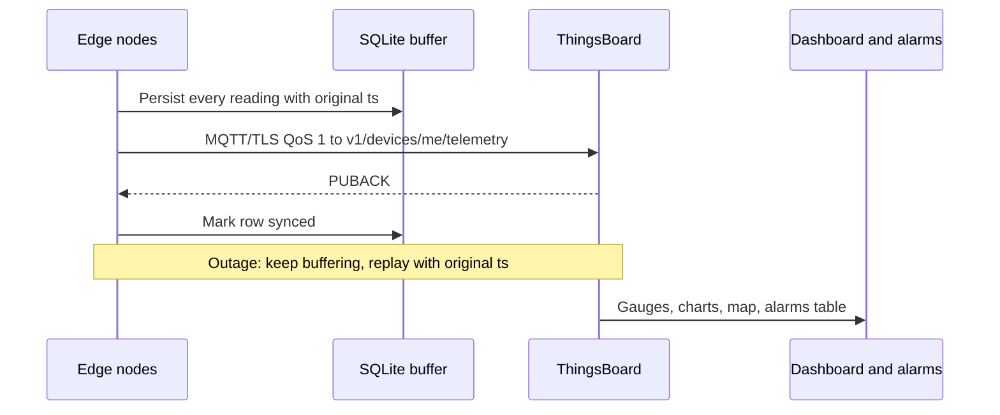

# Cloud track implementation and handoff

Anushree's detailed ThingsBoard provisioning, eight-widget dashboard specification,
evidence checklist and manuscript draft are in [ANUSHREE.md](ANUSHREE.md) and
[ANUSHREE_MANUSCRIPT.md](ANUSHREE_MANUSCRIPT.md). The profile, three devices and dashboard were created on the EU Cloud tenant on 25 November 2026. The API dashboard JSON, redacted profile snapshot and timestamp comparison are in `exports/`; genuine dashboard screenshots and UI import checks are still needed.
`python -m cloud.provision` previews the repeatable device setup. Save a
ThingsBoard API key in ignored `.thingsboard-auth` (key only, one line), then
`python -m cloud.provision --apply` provisions the profile and three devices
through the tenant REST API. The default URL is the user's
`https://eu.thingsboard.cloud`; set `TB_URL` to override it. The API snapshot
it writes is redacted evidence, not a UI export.

This repository implements the edge simulator and now includes provisioning and dashboard configuration for the cloud half. This document is the
actionable checklist for the Cloud Track members: Anushree Pradhan (provisioning and
dashboard) and Sambid Shrestha (alarm rules, WQI rule chain and benchmarking).

Sources for this checklist: `INTEGRATION.md` in this repo (the exact wire/payload/alarm
contract), Assessment Task 3 section C and its metrics table, and the group work-division
PDF. Where the assignment and this repo differ, both values are stated so nothing is
guessed.

## Handoff at a glance

The edge code already implements everything to the left of ThingsBoard: sensor models,
DSP, alarms, validity gates, store-and-forward, per-node MQTT clients and replay. Cloud
work starts at the ThingsBoard instance.

## Connect the edge to ThingsBoard

1. Copy `.env.example` to `.env` and set `TB_HOST`, `TB_CA_CERT` and the three token
   variables. `.env` is git-ignored and must never be committed.
2. Run `python -m edge.cli --mqtt`. The default `--dry-run` emits no network traffic.
3. Confirm `PUBLISH node=...` and `BUFFER: total=...` markers in the console or
   `logs/edge.log`, then confirm the same rows appear in ThingsBoard.
4. Check timestamp preservation: every row carries `{"ts": <epoch ms>, "values": {...}}`.
   ThingsBoard must store that client timestamp, not server receipt time, or the outage
   backfill will appear as a flat spike at recovery time.
5. Keep device names as `node-a`, `node-b`, `node-c`; the edge derives the token variable
   from the node id and will not fall back silently on an empty token.

## Provisioning (Anushree)

- [ ] Choose an instance: `demo.thingsboard.io` or self-hosted Docker CE.
- [ ] Create a Device Profile.
- [ ] Set the profile inactivity timeout to detect node loss. The work division specifies
      180 min normal / 45 min burst; the edge's own `Node Inactive` alarm uses a 90 s demo
      value. These are separate mechanisms — document both rather than equating them.
- [ ] Create at least three devices at distinct coordinates, named `node-a`, `node-b`,
      `node-c`. Coordinates published by the edge: 27.7172/85.3240, 27.6790/85.3190 and
      27.7500/85.3700.
- [ ] Generate an access token per device and put them in `.env` as
      `TB_TOKEN_NODE_A`, `TB_TOKEN_NODE_B`, `TB_TOKEN_NODE_C`.
- [ ] Export the Device Profile JSON for the submission archive.

## Operational dashboard (Anushree)

Build a 5-second triage view: a duty officer should answer "which source is unsafe right
now?" within five seconds of opening it. Organise it for operation, not as a widget gallery.

| Widget | Type | Bound telemetry | Requirement |
| --- | --- | --- | --- |
| pH gauge | Analogue/radial | `ph` | Colour-banded red `<6.5`, green `6.5–8.5`, red `>8.5` |
| Turbidity gauge | Analogue/radial | `turbidity_ntu` | Log or segmented scale, banded at 5/50/200 NTU |
| TDS digital gauge | Digital | `tds_ppm` | Banded at 500/1000 ppm |
| Multi-parameter time series | Time-series, dual axis | `turbidity_ntu`, `ph`, `tds_ppm` | Show the intrusion event and the backfilled gap |
| Temperature and flow | Time-series | `water_temp_c`, `flow_lpm` | Supply-continuity view |
| Node map | OpenStreetMap / GIS | `latitude`, `longitude` plus status | Marker colour driven by alarm severity |
| Alarms table | Alarms widget | — | Active and cleared alarms with severity and duration |
| Node status | Entity table / card | last activity, `buffer_depth` | Fleet health |

`RSSI` is requested by the assignment but the virtual nodes publish no radio telemetry;
mark it N/A rather than inventing values. `buffer_depth` is already published per node.

- [ ] Add fleet-map to individual-node drill-down states (optional extension).
- [ ] Export the dashboard JSON for the submission archive.

## Alarm rules (Sambid)

Configure these in Device Profile → Alarm Rules (preferred) or via a custom rule chain.
The exact deadbands are mandatory; explain the anti-flapping purpose in the manuscript.

| Alarm | Severity | Create | Clear |
| --- | --- | --- | --- |
| High Turbidity | Warning | `turbidity_ntu > 50` | `< 40` NTU |
| Gross Contamination | Critical | `turbidity_ntu > 200` | `< 150` NTU |
| pH Out of Range | Critical | `ph < 6.5` or `> 8.5` | `6.7 ≤ ph ≤ 8.3` |
| High TDS | Critical | `tds_ppm > 500` | `< 450` ppm |
| Supply Interruption | Major | `flow_lpm == 0` sustained | `flow_lpm > 0` |
| Node Inactive | Critical | Device inactivity timeout exceeded | Telemetry resumes |

The edge additionally computes `Rapid Turbidity Rise`, `Severe pH Persistence` and
`Sensor Fault`, and publishes the resulting `severity` and `active_alarms`. Treat the edge
values as authoritative on the dashboard (see below); server-side copies exist for rubric
evidence and must use the same thresholds from `INTEGRATION.md`.

## Server-side WQI rule chain (Sambid)

- [ ] Add a rule-chain script node that computes WQI server-side from incoming telemetry
      using the Task 2 no-chlorine fallback weights, and stores it as a derived key.
- [ ] Export the Rule Chain JSON for the submission archive.
- [ ] Note that the edge already publishes `wqi` and `wqi_band`; keep the server-side value
      consistent with them or display only the edge values.

## Benchmarking (Sambid)

`tools/benchmark_batch_size.py` in this repo measures only the local
enqueue → claim → publish → ack path with no broker. Real-cloud metrics still need a
ThingsBoard run.

| Metric | How to obtain | Report as |
| --- | --- | --- |
| End-to-end latency | generation timestamp vs server receipt | Mean, median, P95, max over ≥ 200 messages |
| Message delivery ratio | messages generated vs rows confirmed synced | Percentage, over a run including an outage |
| Alarm activation delay | threshold breach vs alarm creation in ThingsBoard | Mean over ≥ 10 alarm events |
| Buffer flush throughput | rows replayed per second on reconnection | Messages/second |
| Recovery time | connectivity restored → buffer fully drained | Seconds, for a stated buffer depth |
| Data loss | rows generated vs rows present in ThingsBoard after full sync | Count and percentage |

Plot at least one of these. Determine the optimal batch size empirically using the
existing CSV as a starting point, and re-measure with a real broker.

## Manuscript and live demo (both)

| Owner | Sections / deliverables |
| --- | --- |
| Anushree | 6.3 Part A cloud provisioning and dashboard UX; 7.1 tool justification; 8.1 annotated baseline/intrusion/backfill screenshots. Live: present the dashboard, gauges, GIS colours and historical backfill. |
| Sambid | 6.3 Part B alarm rules and hysteresis anti-flapping; 8.2–8.4 alerting, resilience buffer plots and performance tables; 9–10 conclusion, future work, IEEE references; final Overleaf PDF and submission ZIP. Live: alarm escalations, hysteresis clearing and benchmark results. |
| Both | Export device profile, dashboard JSON and rule chain JSON; retain a full console log of a complete demonstration run including outage and recovery. |

Optional extensions for the Outstanding band: email/webhook notification on Critical
alarms, and a Node-RED flow doing cross-node correlation to localise a breach.

## Edge values versus server-side recomputation

The edge publishes `severity`, `active_alarms`, `node_inactive`, `wqi` and `wqi_band`.
Computing the same values again server-side is acceptable as assignment evidence, but it
can produce contradictory alarms if thresholds drift. Recommended rule: dashboard status
uses the edge-published values; server-side rules and the WQI chain are configured with
the identical thresholds and kept as demonstration artefacts. If a discrepancy appears in
the demo, the edge value wins and the server-side configuration is corrected.
